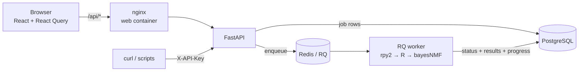

# SigServe

[](https://github.com/nishanthbasava/sigserve/actions/workflows/ci.yml)

A web app and REST API around [bayesNMF](https://github.com/jennalandy/bayesNMF) —
drop in a CSV of mutation counts (or POST a matrix) and get Bayesian NMF
mutational signature results, no R required.

Signature analysis with bayesNMF normally means running an R session for
minutes-to-hours per fit. SigServe turns that into an async web service: jobs
are validated and queued instantly, Gibbs sampling runs on background workers,
and results (MAP signature and exposure matrices plus convergence diagnostics)
are fetched when ready — in the browser as labeled signature/exposure plots
with a convergence trace, or over plain JSON.

## The web UI

Three screens, zero setup for the user:

- **Submit** — drag-and-drop a CSV (samples × 96 trinucleotide contexts,
  validated client-side with cell-level errors), or load the bundled
  synthetic sample dataset. Rank range, iterations, and seed up front;
  fixed rank, likelihood, and prior under Advanced.
- **Jobs** — live-updating table of your runs (status, runtime, size, rank),
  scoped to a per-browser API key minted automatically.
- **Results** — a shareable URL. While running: queue position, elapsed
  time, and the sampler's own log tail. When done: the estimated rank up
  top, per-signature bar plots over the 96 contexts colored by substitution
  class, stacked exposures per sample, a convergence trace (log posterior /
  BIC / RMSE / rank), CSV/JSON downloads, and one-click re-run with
  identical settings. Parameters, seed, and the pinned sampler commit are
  recorded on every result for reproducibility.

## Architecture



- **Web** — Vite/React SPA served by nginx, which also proxies `/api/*`
  to the API so dev and prod are both same-origin (no CORS anywhere).
- **FastAPI** — validation (matrix shape, non-negative counts, rank vs.
  dimensions), hashed API-key auth with self-serve minting (rate-limited),
  job CRUD, re-run, and unauthenticated `/shared/jobs/{id}` reads so result
  URLs are shareable (the random job UUID is the capability).
- **Redis + RQ** — queue and per-job hard timeouts; a failure callback in the
  worker parent catches killed work-horses.
- **PostgreSQL** — source of truth for job state and results (Alembic
  migrations, applied on API startup).
- **Worker image** — R + bayesNMF (pinned commit) bridged via rpy2; embedded R
  initializes in the per-job fork. Scale sampler throughput with
  `--scale worker=N`.
- **Maintenance service** — fails orphaned running jobs, prunes old ones.

## API

Mint a key, then talk JSON with the `X-API-Key` header:

```bash
docker compose exec api python -m sigserve.cli create-key --name alice
```

```bash
# Submit: matrix rows are mutation types, columns are samples
curl -X POST localhost:8000/jobs \
  -H "Content-Type: application/json" -H "X-API-Key: $KEY" \
  -d '{"matrix": [[12,3],[5,8],[9,1]], "params": {"rank": 2, "max_iters": 2000}}'

curl localhost:8000/jobs/<id>          -H "X-API-Key: $KEY"   # status + progress
curl localhost:8000/jobs/<id>/results  -H "X-API-Key: $KEY"   # 409 until finished
curl localhost:8000/jobs               -H "X-API-Key: $KEY"   # list my jobs
curl -X POST localhost:8000/jobs/<id>/rerun -H "X-API-Key: $KEY"  # same input + params
curl -X DELETE localhost:8000/jobs/<id> -H "X-API-Key: $KEY"  # cancel
curl localhost:8000/shared/jobs/<id>/results                  # no key: shareable read
```

Interactive docs at `/docs`. Keys can also be minted over HTTP
(`POST /keys`, per-IP rate limit) — that's what the web UI does.

Parameters: a fixed `rank` (1–20, ≤ smaller matrix dimension) **or** a
`rank_min`/`rank_max` range (bayesNMF's SBFI rank learning picks the best
rank), `max_iters` (100–20 000), `seed` (reproducible runs), `likelihood`
(poisson/normal), and `prior` (truncnormal/exponential/gamma). Submissions
may carry a dataset `name` plus `mutation_types`/`sample_names` labels,
echoed back with results. Results contain `signatures` (types × rank),
`exposures` (rank × samples), and `diagnostics` (engine + pinned commit,
estimated rank, convergence, seed, timing, and a per-checkpoint trace of
RMSE / log-likelihood / log-posterior / BIC / rank).

## Development

Requires Python 3.11+.

```bash
uv venv --python 3.13
uv pip install -e ".[dev]"
.venv/bin/pytest          # unit tests (SQLite + fakeredis, no services)
```

Frontend (Vite dev server on :5173, proxying `/api` to the API):

```bash
cd web && npm install && npm run dev
```

Tip: run the API with `SAMPLER_ENGINE=stub` during frontend work — jobs
finish instantly with plausible shapes, traces, and diagnostics.

Full stack and integration tests (web UI on :8080, API on :8000):

```bash
cp .env.example .env
docker compose up -d --build
.venv/bin/pytest -m integration
```

Golden tests check that the real sampler recovers planted signatures; they
need R, so they run inside the worker image:

```bash
docker compose run --rm --no-deps -v ./tests:/app/tests worker \
    sh -c 'pip install -q ".[dev]" && pytest -m golden'
```

CI runs lint + unit tests (coverage gated at 85%) on every push, then builds
the stack and runs the end-to-end and golden tests against the real sampler.

## Performance

`scripts/loadtest.js` (k6) drives the submit/poll path — see the script
header for how to run it. Measured at 20 concurrent users, 90 s, zero
failures:

| Environment | Throughput | p95 latency |
|---|---|---|
| AWS EC2 (m7i-flex.large, full TLS path via Caddy) | 191 req/s | 89 ms |
| Local Docker stack (M-series Mac) | 282 req/s | 24 ms |

Sampler throughput scales separately with worker count (one MCMC per
worker).

`scripts/analytics.sql` reports on the jobs table — daily success rate with
a 7-day rolling window, queue-latency percentiles, sampler runtime bucketed
by matrix size, and per-key usage:

```bash
docker compose exec -T postgres psql -U sigserve sigserve < scripts/analytics.sql
```

## Deployment

One VM, Docker Compose, Caddy for automatic HTTPS (set `SIGSERVE_DOMAIN`
in `.env`):

```bash
docker compose -f docker-compose.prod.yml up -d --build
```

Full EC2 runbook in [docs/deploy.md](docs/deploy.md).

## Acknowledgments

The sampler is [bayesNMF](https://github.com/jennalandy/bayesNMF) by Jenna
Landy; SigServe pins a specific commit and adds no statistical methodology of
its own.
